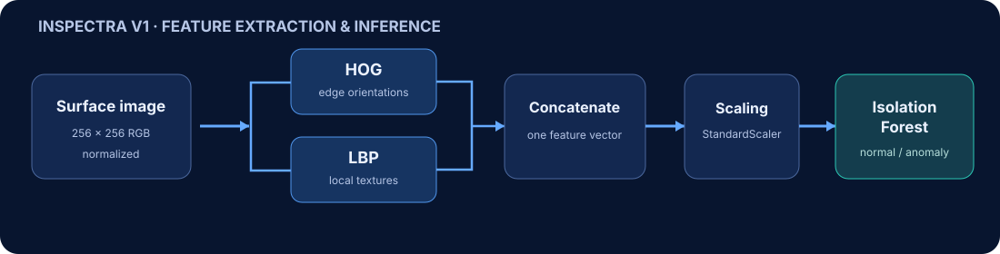
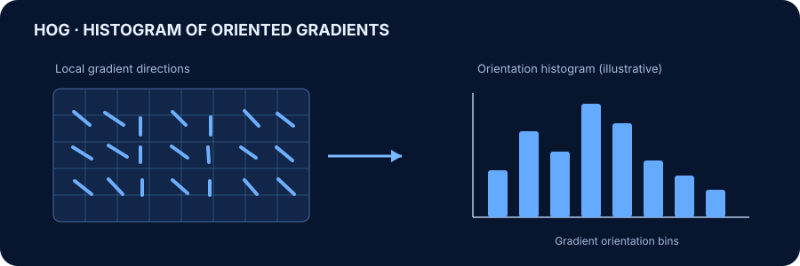
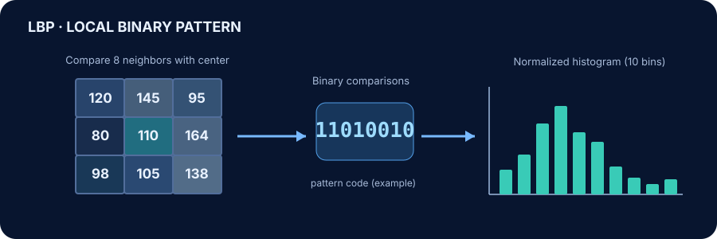

# Inspectra

**Industrial Surface Defect Detection — Research Prototype, Version 1**

Inspectra is an experimental computer-vision platform for exploring **image-level surface anomaly detection** in manufactured products. Its first version investigates whether handcrafted texture and gradient descriptors, combined with an unsupervised anomaly detection model, can distinguish normal product images from potentially defective ones.

> [!IMPORTANT]
> **Research and educational use only.** Inspectra is a proof of concept, **not** a certified, validated, or production-ready industrial quality-control product. Its predictions are experimental and must not be used to accept or reject manufactured goods, make safety-critical decisions, or replace human inspection. The project does not claim suitability for commercial or operational deployment.

## The research problem

Manufactured surfaces can contain scratches, cracks, contamination, missing elements, and irregular textures. These defects vary between product categories, and labeled defective samples may be limited.

Inspectra studies **normal-only training**: learning the characteristics of defect-free samples, then identifying images that depart from those characteristics. The approach is evaluated using images from **MVTec AD**, a public industrial anomaly detection benchmark.

## Dataset — MVTec AD

**MVTec Anomaly Detection (MVTec AD)** was created and published by researchers at **MVTec Software GmbH**. The original CVPR 2019 dataset paper is authored by **Paul Bergmann, Michael Fauser, David Sattlegger, and Carsten Steger**. We gratefully acknowledge their contribution to industrial visual anomaly-detection research.

The dataset contains **5,354 high-resolution images across 15 object and texture categories**. It provides defect-free training images, normal and anomalous test images, and pixel-precise anomaly annotations. Inspectra v1 uses its **image-level** labels for evaluation; it does **not** implement pixel-level defect localization.

Examples of included categories are bottle, cable, zipper, metal nut, leather, wood, and grid.

**Original dataset and publication:**

- Dataset homepage: [MVTec AD — MVTec Software GmbH](https://www.mvtec.com/research-teaching/datasets/mvtec-ad)
- Original paper: [*MVTec AD — A Comprehensive Real-World Dataset for Unsupervised Anomaly Detection* (CVPR 2019)](https://openaccess.thecvf.com/content_CVPR_2019/html/Bergmann_MVTec_AD_--_A_Comprehensive_Real-World_Dataset_for_Unsupervised_Anomaly_CVPR_2019_paper.html)

**Dataset license:** MVTec AD is distributed under **Creative Commons Attribution–NonCommercial–ShareAlike 4.0 International (CC BY-NC-SA 4.0)**. **Commercial use of the dataset is not permitted under this license.** The dataset remains the work of its original creators; Inspectra is an independent research project and is **not affiliated with or endorsed by MVTec**. Consult the [official dataset page](https://www.mvtec.com/research-teaching/datasets/mvtec-ad) and [license terms](https://creativecommons.org/licenses/by-nc-sa/4.0/) before using or redistributing any dataset content.

### Dataset citation

```bibtex
@inproceedings{bergmann2019mvtec,
  title     = {MVTec AD -- A Comprehensive Real-World Dataset for Unsupervised Anomaly Detection},
  author    = {Bergmann, Paul and Fauser, Michael and Sattlegger, David and Steger, Carsten},
  booktitle = {Proceedings of the IEEE/CVF Conference on Computer Vision and Pattern Recognition (CVPR)},
  year      = {2019}
}
```

## Version 1 — Classical unsupervised anomaly detection

The initial implementation is intentionally simple and reproducible. **Isolation Forest** is the available anomaly detection model; additional methods may be explored in future experiments but are **not implemented in v1**.

1. **Prepare images:** convert to RGB, resize to **256 × 256**, and normalize pixel intensities to **[0, 1]**.
2. **Extract features:** compute **Histograms of Oriented Gradients (HOG)** and a **Local Binary Pattern (LBP)** histogram for each image.
3. **Combine descriptors:** concatenate the HOG and LBP outputs into a single numerical feature vector.
4. **Train by category:** fit a separate **StandardScaler + Isolation Forest** pipeline for each MVTec AD product category, using its normal training images.
5. **Inspect an image:** apply the same preprocessing and feature extraction, then use the relevant model to obtain a classification and raw anomaly score.
6. **Evaluate:** report image-level classification and ranking metrics on labeled evaluation images.

**Prediction labels:** `0` = **Normal**; `1` = **Potential anomaly / defect**. The reported anomaly score is a **raw model score, not a probability of defect**.

### Feature extraction at a glance



#### HOG — gradients and edges

HOG summarizes the distribution of local edge orientations. In Inspectra it captures structures such as contours, lines, and changes in surface shape. The schematic below shows a patch of oriented gradients contributing to an orientation histogram.



#### LBP — local texture patterns

LBP compares a pixel with its neighbors, encoding the relative intensity pattern into a texture descriptor. Inspectra uses **8 neighbors**, **radius 1**, and **uniform LBP**; the resulting **10-bin normalized histogram** complements the HOG vector.



*These graphics are explanatory illustrations of the feature extraction method, not screenshots of measured features from MVTec AD images.*

## The Inspectra platform

The platform provides an interactive way to explore this research workflow rather than relying only on notebooks or command-line scripts.

**Explore models.** Visitors can inspect the available method, see which algorithms are currently supported, and open the Isolation Forest workspace.

**Examine evaluation results.** Selecting a product category presents that category's saved model evaluation metrics, including accuracy, precision, recall, F1, ROC-AUC, and average precision when available.

**Run an image inspection.** Users choose a supported product category, upload an image, preview it locally, and request an inspection. The platform returns an **image-level** normal/anomalous classification and anomaly score from the corresponding trained model.

**Understand the experiment.** The site introduces the dataset, the initial anomaly-detection approach, and the limits of the prototype. Visual demonstrations on the site may be illustrative and should not be interpreted as verified pixel-level detection results.

## Current limitations and research direction

- **Image-level detection only:** the model does not locate or segment the defective region.
- **Category-specific models:** inspection assumes the user selects the appropriate MVTec AD product category.
- **Threshold sensitivity:** a useful anomaly ranking does not guarantee strong recall or precision at the default decision threshold.
- **Controlled benchmark:** results on MVTec AD do not establish reliability on unseen factory cameras, conditions, or production lines.
- **Future experiments:** controlled data augmentation, threshold calibration using validation data, and comparisons with other anomaly-detection approaches.

## Research, attribution, and responsibility

Inspectra is developed **solely for research, learning, and methodological evaluation**. The project is not intended for manufacturing decisions, commercial inspection services, regulatory compliance, or safety-critical use.

**The MVTec AD dataset belongs to its original creators.** This project does not claim authorship or ownership of the dataset. Please credit MVTec Software GmbH and cite the original Bergmann *et al.* (2019) publication when using MVTec AD in scientific work. Dataset images and annotations should be obtained and handled according to their separate license; they are not automatically licensed under any license used for Inspectra's source code.

---

**Project development:** [GitHub — elmoujahidayoub171](https://github.com/elmoujahidayoub171)  
**Status:** Research prototype · Version 1
